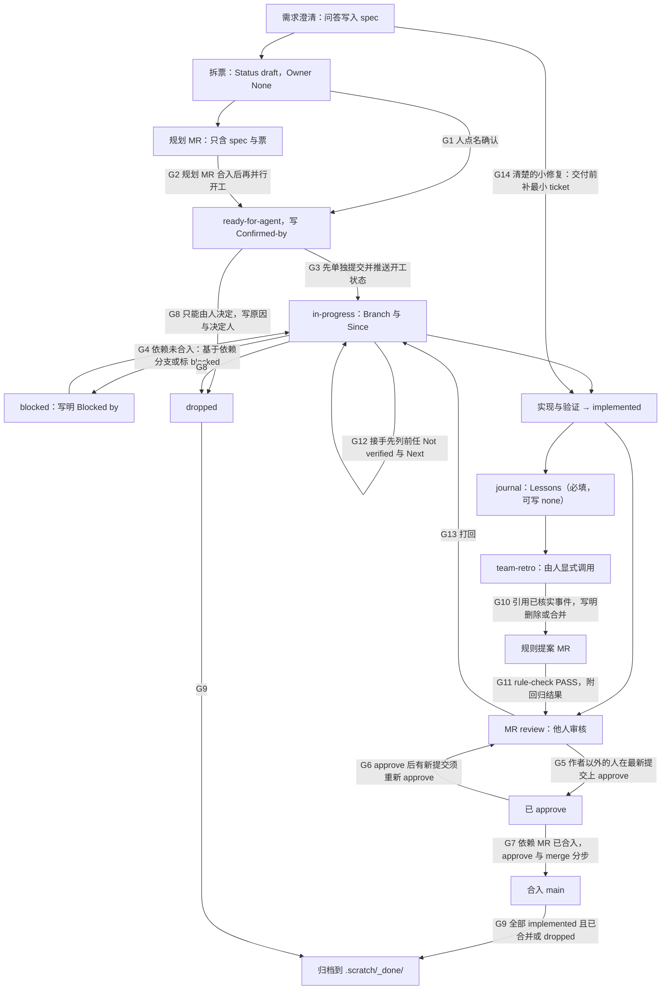

# 团队流程图

本文件把 `docs/agents/team.md` 与 `docs/agents/issue-tracker.md` 中的流程画成一张带版本的图：节点是步骤，边是流转，边上的 `G<n>` 是闸门。图只是总览，**规则以文字为准**；发现图与文字不一致时，按文字执行并向用户报告。日常开发不需要读取。

规则文字中描述流程步骤的句子末尾带有标记 `<!-- flow: <ID> -->`，ID 是本图的节点 ID 或闸门编号，可写多个，用空格分隔。`rule-check` 双向检查：每个标记都要在图中有对应的节点或闸门；每个闸门都要在“规则出处”文件中有标记。新增流程步骤时先加标记，再改图。

修改流程（增删步骤、流转或闸门）时，按 `team.md` 的“规则迭代与保护”提 MR。每次只做一个小改动：增加或删除一个节点、一条边或一个闸门。同时修改对应的规则文字，并在 `docs/agents/rule-log.md` 登记来源。节点、边、闸门的数量受 `rule-log.md` 的“流程图预算”约束，由 `docs/agents/scripts/rule-check` 检查。闸门上限固定为 15：新增闸门只经 `team-retro` 提案，并写明删除或合并哪个闸门。

## 闸门

`rule-check` 检查：每个闸门都出现在图中的某条边上，并在规则出处文件中有 `flow` 标记；图中的每个 `G<n>` 都在本表中；“规则原文”逐字出现在“规则出处”文件中（忽略 Markdown 强调符号和多余空格）。规则文字改动导致原文对不上时，要同时更新本表或图。

| 闸门 | 含义 | 规则出处 | 规则原文 |
| --- | --- | --- | --- |
| G1 | 只有人点名确认才进入 ready-for-agent | docs/agents/issue-tracker.md | 只有用户在当前会话中点名某张票 |
| G2 | 多人并行先合入规划 MR | docs/agents/team.md | 先由 feature 负责人提交一个只含 spec 与拆票的规划 MR |
| G3 | 开工第一步单独提交并推送 in-progress | docs/agents/issue-tracker.md | 单独提交并推送，然后再开始实现 |
| G4 | 依赖未合入时基于依赖分支开工或标 blocked | docs/agents/issue-tracker.md | 从依赖票的 `Branch:` 分支开出本票分支 |
| G5 | 作者以外的成员在最新提交上 approve；先核对功能地图已随用户可见行为更新 | docs/agents/team.md | 需要作者以外的成员在 MR 的最新提交上 approve |
| G6 | approve 后的新提交需要重新 approve | docs/agents/team.md | 都要重新 approve 后才能合并 |
| G7 | 依赖 MR 先合；approve 与 merge 分步执行 | docs/agents/team.md | 不把 approve 与 merge 串成一条命令 |
| G8 | dropped 只能由人设置 | docs/agents/issue-tracker.md | 不再执行；在正文写明原因与决定人 |
| G9 | 归档前提 | docs/agents/issue-tracker.md | Feature 的票全部为 implemented（且 MR 已合并）或 dropped 后 |
| G10 | retro 提案引用已核实事件并写删除 | docs/agents/team.md | 每项引用已核实的事件，写明删除或合并的现有规则 |
| G11 | 改规则的 MR 附检查与回归结果 | docs/agents/team.md | rule-check 为 FAIL（超出预算、缺来源）时不合入 |
| G12 | 接手先列前任未验证项与下一步 | docs/agents/team.md | 接手后先向用户列出前任最近 journal 中的 Not verified 与 Next |
| G13 | 审核打回回到 in-progress | docs/agents/issue-tracker.md | MR 审核打回时由 `implemented` 回到 `in-progress` |
| G14 | 小修复不经 ready-for-agent，请求即确认 | docs/agents/issue-tracker.md | Status 写 implemented，`Confirmed-by:` 写提出请求的成员与日期 |
